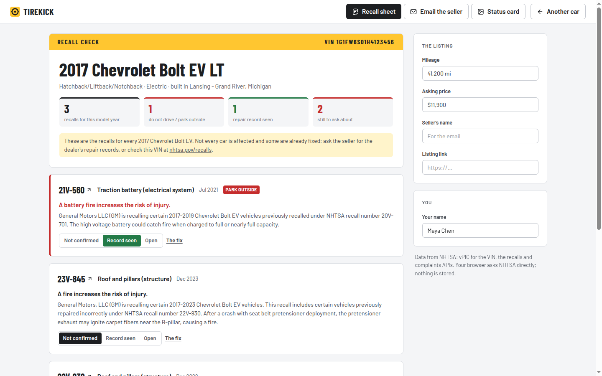
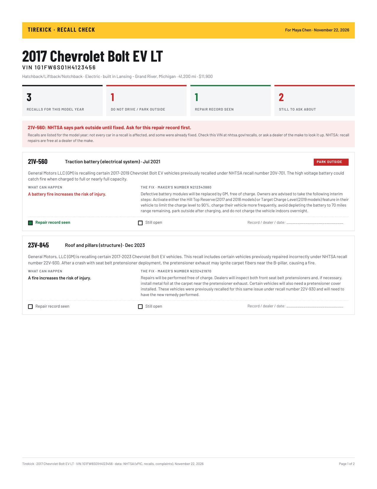
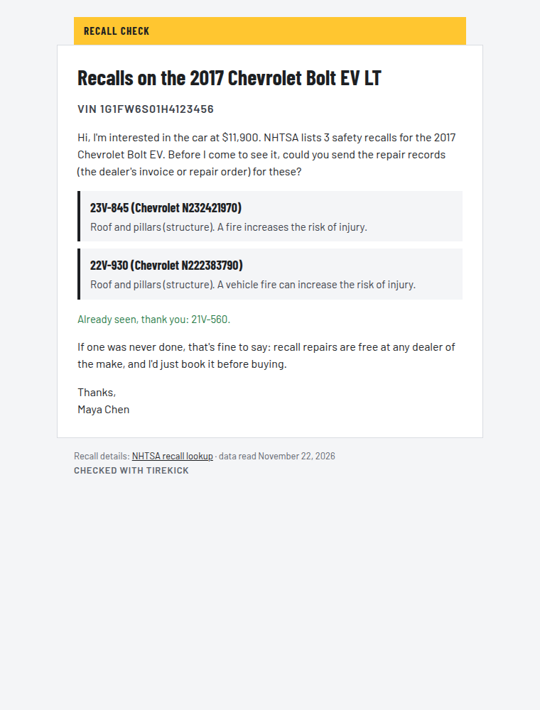
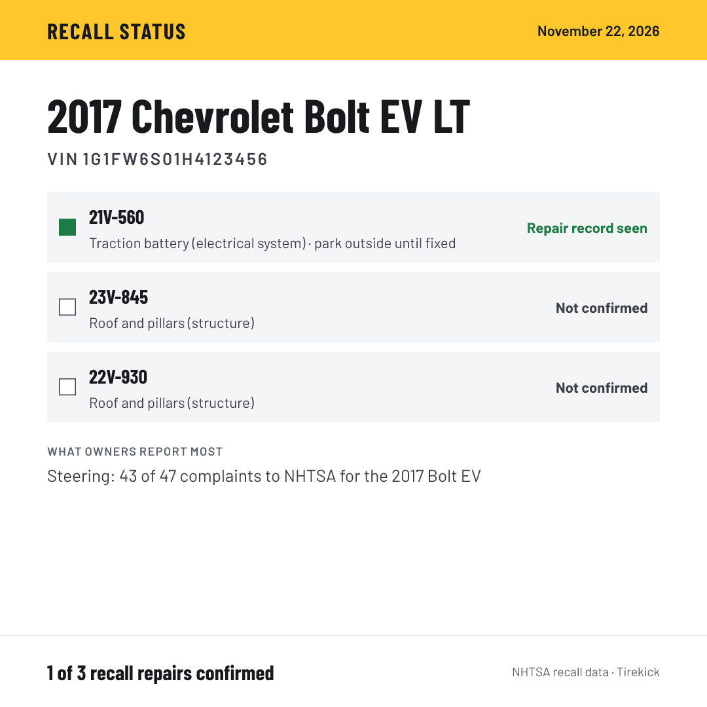

# Tirekick

**Kick the tires. Then check the recalls.** Type the VIN of the used car you're looking at. Tirekick asks NHTSA for
the car, every safety recall for its model year and what owners complain about, puts the do-not-drive and
park-outside recalls first, and makes:

- a recall sheet (PDF, US Letter) to take to the viewing: each recall with what can happen, the fix, the maker's
  recall number, and a box to tick when the seller shows the repair record
- an email to the seller asking for the repair records, recall by recall
- a recall status card (PNG) for the listing or the group chat

Built with [Hyper Elements](https://github.com/hyper-elements/hyper-elements) for the Hyper Elements Template Challenge.

**Live:** https://tirekick.rohitkashyapmrt.workers.dev



## Why this exists

A recall repair is free at any dealer of the make, but a used car can be sold with the work still undone. On
r/UsedCars: "Used car has two open recalls, dealer says I need to complete purchase first"
([Jul 2024](https://www.reddit.com/r/UsedCars/comments/1e762gp/), a Honda with a fuel pump recall; the replies: "go
to the NHTSA website, type in the VIN, and read all the recall information"). "Why would a franchise dealership sell a
late model vehicle with open recalls?" ([r/UsedCars](https://www.reddit.com/r/UsedCars/comments/1wnfl66/)). "If you're
buying a Pilot, Ridgeline or Passport in a salt state, there's a subframe recall with no fix available yet"
([r/UsedCars](https://www.reddit.com/r/UsedCars/comments/1xoihx4/)).

NHTSA's own VIN lookup ([nhtsa.gov/recalls](https://www.nhtsa.gov/recalls)) answers for one car, but it sits behind a
reCAPTCHA with no API, and it gives a web page, not something to take to the viewing or send to the seller. NHTSA's
open APIs give the model-year recalls and complaints. Tirekick turns those into the questions to ask, and the record of
the answers.

**A real example.** A 2017 Chevrolet Bolt EV LT (a made-up VIN with a valid check digit, `1G1FW6S01H4123456`, which
NHTSA decodes clean):

| Recall | Part | What NHTSA says | |
|---|---|---|---|
| 21V-560 | Traction battery | The battery could catch fire when charged to full or nearly full. Defective modules replaced by GM, free. | park outside |
| 23V-845 | Seat belt pretensioner | After a crash the pretensioner exhaust may ignite carpet near the B-pillar; includes cars repaired incorrectly under 22V-930. | |
| 22V-930 | Seat belt pretensioner | The first recall for the same fire risk. | |
| 20V-701 | Traction battery | Superseded by 21V-560. | |

Plus 47 owner complaints, 43 of them about the steering.

| Recall sheet, page 1 | Email to the seller | Status card |
|---|---|---|
|  |  |  |

The landing page (7 sections with an FAQ): [media/landing.png](media/landing.png). On a phone:
[media/mobile.png](media/mobile.png) and [media/mobile-check.png](media/mobile-check.png). The sample sheet:
[public/landing/recall-sheet.pdf](public/landing/recall-sheet.pdf).

## How it works

| Step | What happens |
|---|---|
| **Type the VIN** | `checkVin` in `templates/_shared/car.ts`: 17 characters, no I/O/Q, and the 9th-position check digit for North American VINs, so a typo is caught before anything is looked up. |
| **Decode** | NHTSA vPIC `DecodeVinValues`: year, make, model, trim, body, fuel, plant. |
| **Recalls** | `api.nhtsa.gov/recalls/recallsByVehicle` for that year, make and model. If NHTSA's recall data names the model differently, the models NHTSA lists for that make and year (`products/vehicle/models`) are tried. Ranked: do not drive, park outside, then fire/crash/brake/steering risks, then the rest; superseded recalls last and not counted. The remedy text loses the paperwork (letters mailed, phone numbers) and leads with the sentence that says what gets fixed; the maker's recall number is pulled out. "No fix yet" is read from NHTSA's wording ("remedy becoming available", "not yet available"), not from routine "interim letters". |
| **Complaints** | `api.nhtsa.gov/complaints/complaintsByVehicle`: totals, crashes, fires, injuries, deaths, and the most-reported components. |
| **Mark and send** | Mark each recall not confirmed, repair record seen, or open. Preview and download the sheet, the email and the card. |

All three NHTSA APIs answer the browser directly, so the site is static and nothing is stored.

## How Hyper Elements is used

The three outputs are **Hyper Elements templates** in `templates/`. The app renders them in the browser
(`src/lib/render-route.ts`, so the site runs on Cloudflare as static files), and the CLI renders the same files.

- **Typed fields with rules:** the VIN must match the VIN alphabet (no I, O, Q), each recall id must look like
  `21V-560`, NHTSA's warning is a `prop.choice` ("Do not drive", "Park outside"), each recall's status is one of
  three, the complaints are a typed object. Values outside the rules stop the render with the field and the reason.
- **`<Document>` + `renderPdf()`** for the US Letter sheet, in Barlow and Barlow Condensed: a window-sticker yellow
  band, four counts, the urgent recall called out, then a card per recall with "what can happen", "the fix", the
  maker's number and the proof boxes, and a complaints bar chart. Pages are planned from estimated heights, because a
  Document page doesn't flow by itself.
- **`<Email>`** to the seller, with lint (`lang`, `contrast`, `link-text`), the email client checks and preview text
  required. It names each recall still to confirm by NHTSA's and the maker's number and thanks the seller for the ones
  already seen.
- **`<Canvas>` + `renderImage()`** for the 1080 × 1080 status card, with `image/overflow`, `image/glyph` and
  `image/fit` required; long car names and parts step down through `fit` sizes.
- **Values files + CLI:** `npm run sheets` turns `docs/sample.json` into values files with `hyper-elements design
  new`, then renders all three with `hyper-elements render`.

## Run it

Needs Node 22.6+.

```bash
npm install
npm run dev            # http://localhost:3000 (landing) and /check (the dashboard)
```

```bash
npm test               # VIN checks, the sample's decode, recall order, remedy cleanup, "no fix yet", complaints (7 tests)
npm run check          # check the three templates with their example
npm run sheets         # docs/sample.json → renders/docs/ (sheet PDF, email, card PNG)
npm run sample         # ask NHTSA again for the sample car and rebuild the sample
npm run preview:email  # the email as each email client draws it
npm run build && npx wrangler dev   # the static site, served the way Cloudflare does
```

## Project layout

```
templates/_shared/car.ts      VIN check, vPIC decode, recalls (ranking, remedy cleanup), complaints, values
templates/_shared/doc.tsx     fields, the window-sticker look, status words
templates/_shared/example.ts  the sample (generated by scripts/sample.ts)
templates/sheet.tsx           <Document>: the recall sheet
templates/ask.tsx             <Email>: the email to the seller
templates/card.tsx            <Canvas>: the status card
src/lib/load.ts               the NHTSA lookups, or the sample
src/lib/render-route.ts       renders the templates in the browser
src/components/Garage.tsx     the dashboard
src/app/page.tsx              the landing page
public/samples/               NHTSA's answers for the sample car, as returned on 22 November 2026
tests/                        tests
```

## Sample data

`public/samples/decode.json`, `recalls.json` and `complaints.json` are NHTSA's answers for the sample VIN, read on
22 November 2026. The VIN `1G1FW6S01H4123456` is made up (its check digit is valid, so NHTSA decodes it as a 2017
Chevrolet Bolt EV LT); it is not a car we know of. Maya Chen, the mileage and the price are made up. Tirekick is not
affiliated with NHTSA or any carmaker.

## License

MIT for the code. Fonts: Barlow and Barlow Condensed, SIL Open Font License 1.1.
